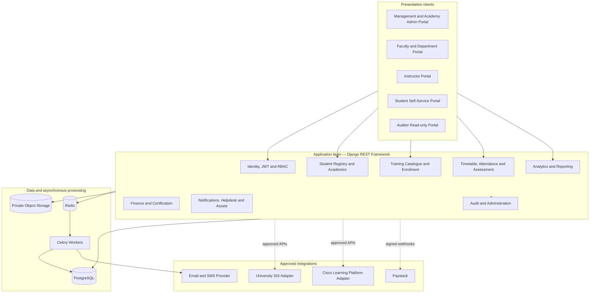

# System architecture — VUNA Cisco NetAcad 2.0

The architecture is a modular monolith, not a microservice estate. Each domain module owns its business rules and data boundaries while sharing a single PostgreSQL deployment. External integrations are adapters and remain disabled until the institution authorises access and supplies supported interfaces.
